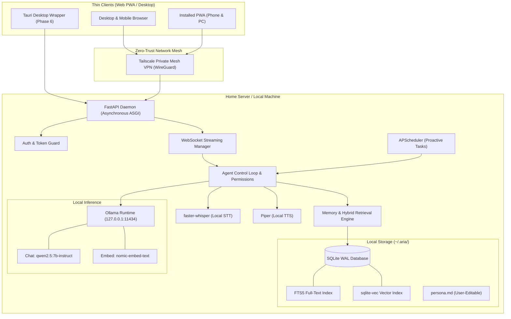

# System Architecture

## 1. Overview

`aria-local-agent` is designed as a single-host, multi-device personal assistant. The system centers on a lightweight home server daemon powering thin client applications (Web PWA, mobile browser, and optional desktop wrapper) via private local networking.

---

## 2. Core Components

### 2.1 Backend Daemon (`backend/app`)
- **FastAPI Application:** Serves REST API endpoints for session management, tool approval, memory administration, and a WebSocket endpoint (`/ws/chat`) for token streaming.
- **Asynchronous Execution:** Handles non-blocking LLM streaming, database operations, and tool actions without stalling the main event loop.
- **Local State & Config:** Configured strictly via environment variables and `config.py`. Operates against a single local user profile.

### 2.2 Storage Layer (`backend/app/db`)
- **Engine:** SQLite with Write-Ahead Logging (WAL) enabled (`PRAGMA journal_mode=WAL;`), providing fast concurrent reads and atomic commits.
- **Hybrid Search Engine:**
  - **FTS5:** Token-based keyword matching with porter stemmer.
  - **sqlite-vec:** Dense embedding index mapped to `nomic-embed-text` 768-dimensional vectors.
  - **Reciprocal Rank Fusion (RRF):** Blends vector similarity and FTS5 ranking for retrieval.

### 2.3 Memory Subsystem (`backend/app/memory`)
- **Chunking & Indexing:** Slices chat transcripts into semantic chunks upon receipt or session idle.
- **Context Injection:** Injects top-$k$ relevant memories into the prompt before generating LLM completions within a strict token budget.
- **Profile Facts:** Extracted automatically from conversation into `profile_facts`. Strict human-in-the-loop lifecycle (`pending` -> `approved` -> active).

### 2.4 Agent Execution & Safety (`backend/app/agent`)
- **Modular Tool Registry:** Tools register structured JSON schemas and risk classifications.
- **Safety Interceptor:** Low-risk tools run automatically with audit logs; medium and high-risk tools require explicit owner approval via WebSocket/REST.
- **Kill Switch:** Hardware-level interrupt pattern halting executing tasks, cancelling sub-processes, and draining pending queues immediately.

---

## 3. Data Flow

### 3.1 Conversational Turn
1. Client sends message via WebSocket (`/ws/chat`).
2. Server validates device token and writes message to `messages` table immediately.
3. Memory engine embeds the prompt and executes hybrid query (FTS5 + sqlite-vec).
4. System prompt + approved profile facts + top-$k$ memories + recent history are assembled.
5. Prompt streamed to Ollama; generated tokens streamed back over WebSocket.
6. Once response completes, assistant message is committed to database and queued for fact extraction.
